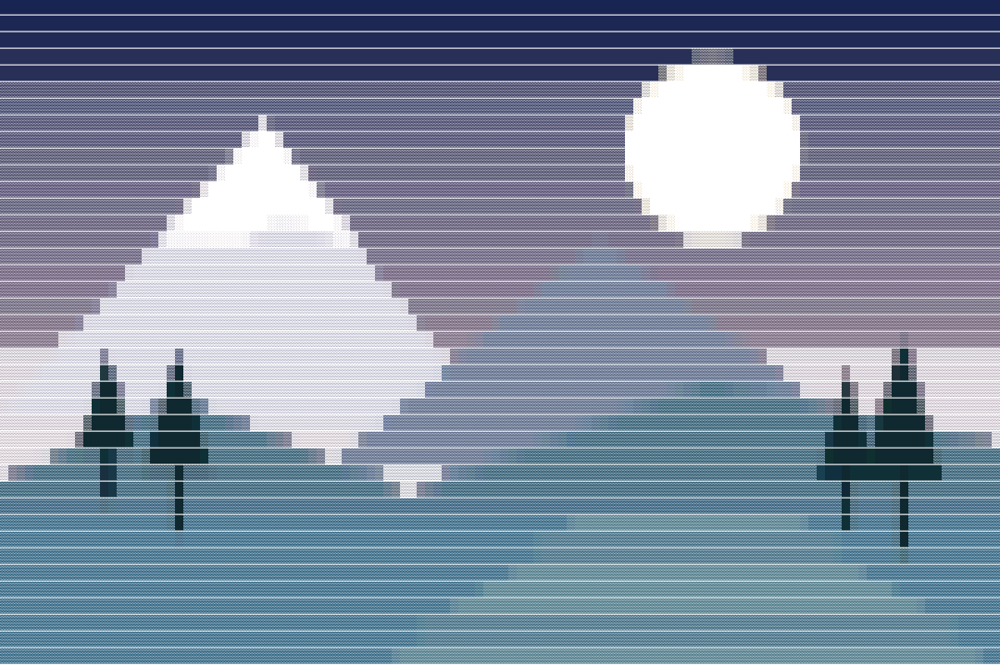
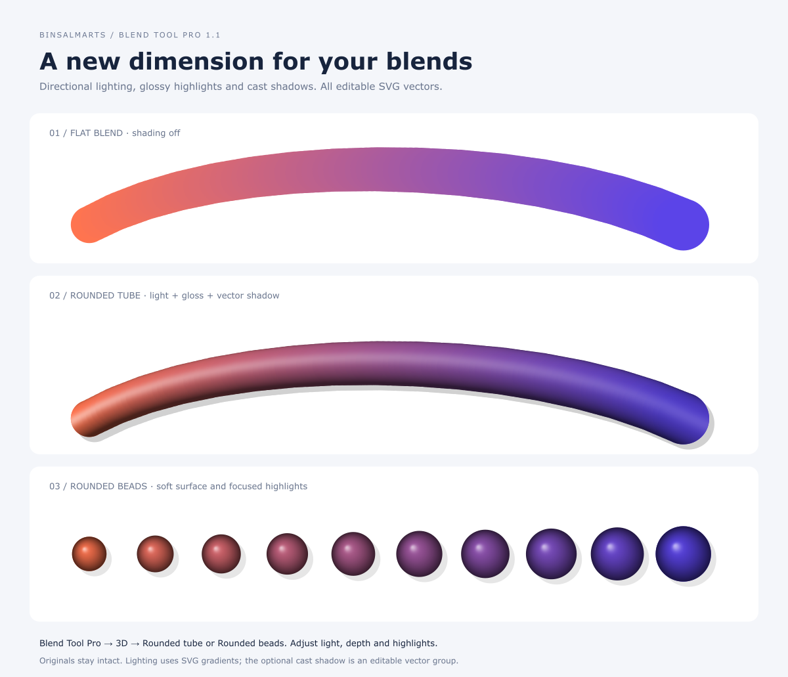
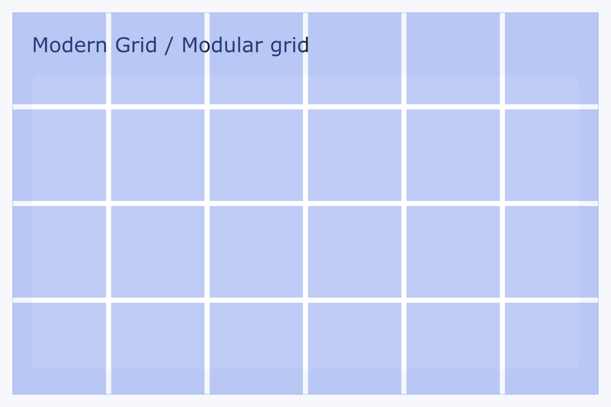
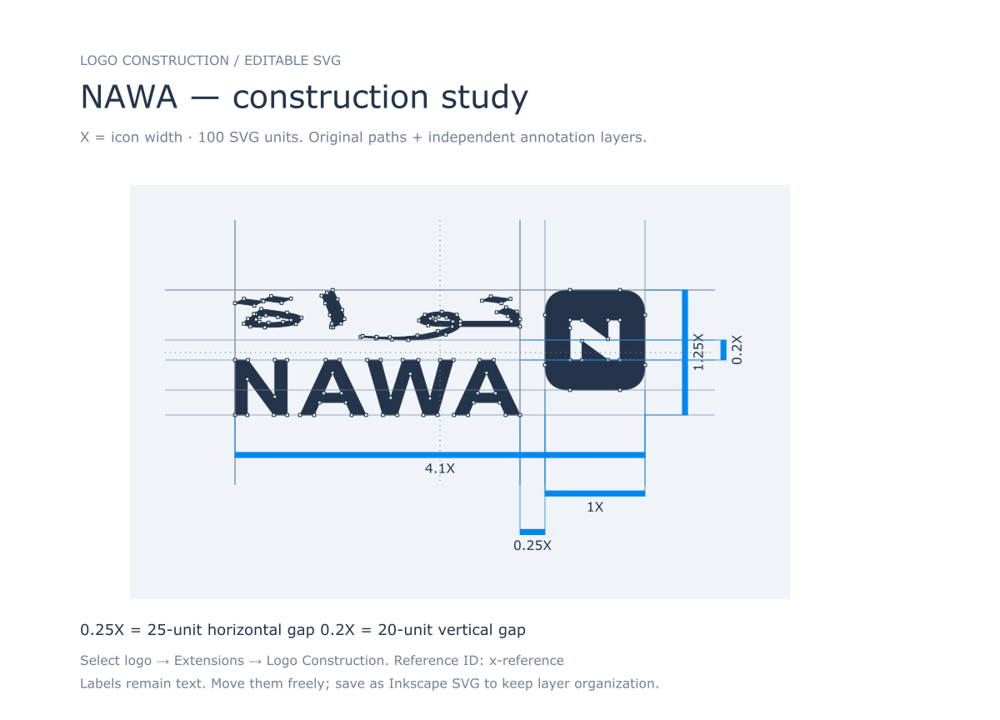
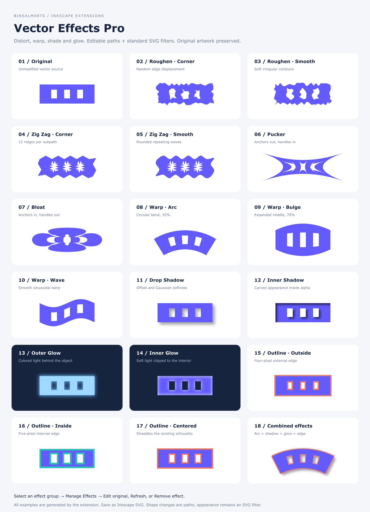
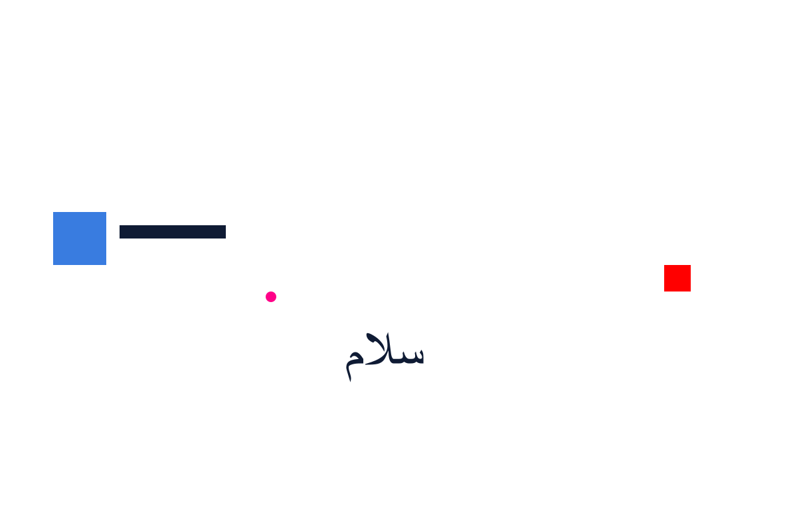
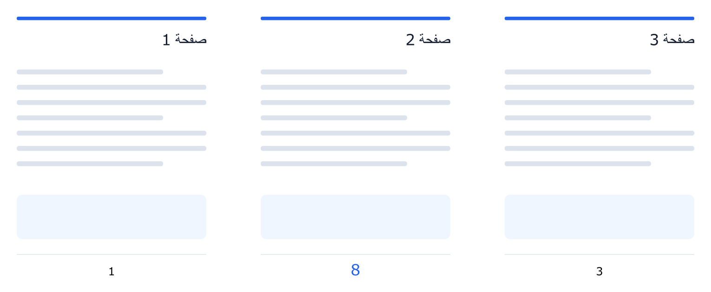
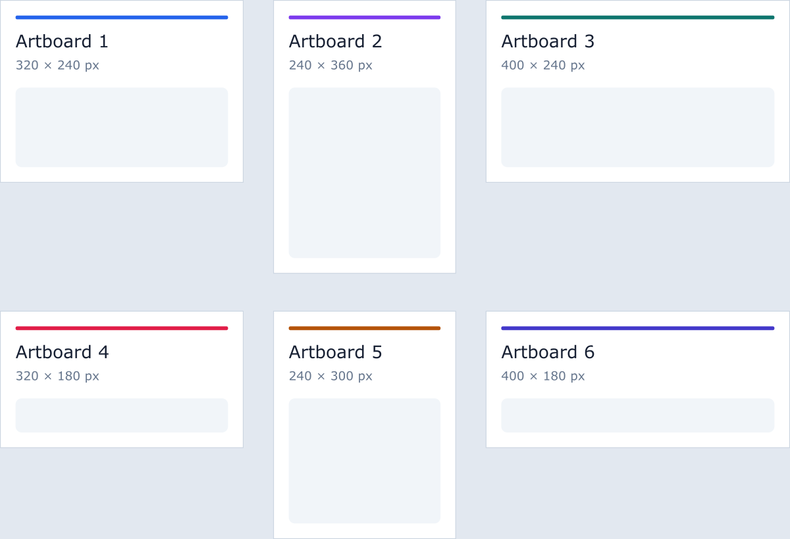
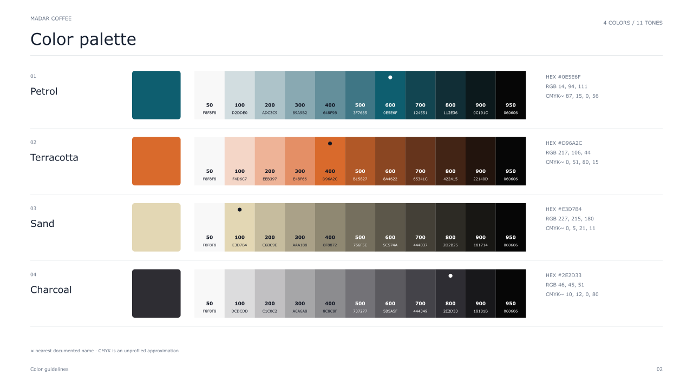
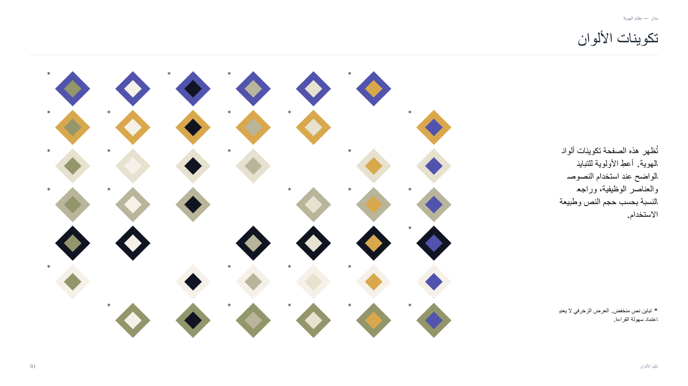

# Binsalmarts Extensions for Inkscape

[](https://github.com/binsalmarts/Binsalmarts-Extensions/actions/workflows/ci.yml)
[](https://github.com/binsalmarts/Binsalmarts-Extensions/releases/latest)
[](LICENSE)

**٩ إضافات للتصميم في Inkscape**: إنشاء الصفحات والشبكات، ترقيمها، بناء الشعارات وتصديرها، مزج الأشكال، مؤثرات الفيكتور، وتحويل الصور إلى ASCII. معها أمثلة SVG قابلة للتحرير، وثيم Studio Dark Compact في حزمة مستقلة.

Nine Inkscape extensions for layout, logos and editable vector artwork, with SVG examples and a separate macOS theme. Requires **Inkscape 1.4+**. Extension interfaces are English; Arabic artwork is supported where described in each guide.

**[تنزيل آخر إصدار · Download](https://github.com/binsalmarts/Binsalmarts-Extensions/releases/latest)** · **[التثبيت](docs/INSTALLATION.md)** · **[الأمثلة](examples/README.md)** · **[الإبلاغ عن مشكلة](https://github.com/binsalmarts/Binsalmarts-Extensions/issues/new/choose)**

## الإضافات

| الإضافة | الإصدار | الاستخدام | الدليل | مثال SVG |
| --- | --- | --- | --- | --- |
| ASCII Art Pro | 1.2.0 | تحويل الصور إلى أحرف ونصوص قابلة للتحرير، مع دعم الأحرف العربية | [الدليل](ASCII_ART_README.md) | [ملون](examples/color.svg) |
| Page Numbering Pro | 1.2.0 | ترقيم الصفحات، أرقام عربية وأصفار بادئة وقوالب مخصصة | [الدليل](PAGE_NUMBERING_README.md) | [ترقيم عربي](examples/page_numbering/arabic_leading_zeros.svg) |
| Modern Grid | 4.4.0 | شبكات أعمدة وصفوف ووحدات وBento للصفحات أو العناصر | [الدليل](modern_grid/README.md) | [شبكة وحدات](examples/modern_grid/grid.svg) |
| Artboard Maker Pro | 1.0.0 | إنشاء صفحات Inkscape أصلية بمقاسات موحدة أو مختلطة | [الدليل](ARTBOARD_MAKER_README.md) | [مقاسات مختلطة](examples/artboard_maker/mixed.svg) |
| Logo Export Pro | 2.0.0 | تصدير الشعارات وقوالب الهوية إلى صيغ وألوان متعددة | [الدليل](LOGO_EXPORT_README.md) | [قوالب الهوية](examples/logo_export/named-templates.svg) |
| Logo Construction | 1.0.0 | مخطط بناء الشعار، القياسات والمراجع الهندسية | [الدليل](LOGO_CONSTRUCTION_README.md) | [المخطط](examples/logo_construction/construction-demo.svg) |
| Blend Tool Pro | 1.1.0 | مزج الأشكال والألوان على خط أو منحنى مع مظهر ثلاثي الأبعاد | [الدليل](BLEND_TOOL_README.md) | [مزج 3D](examples/blend_tool/blend-3d-demo.svg) |
| Vector Effects Pro | 1.2.0 | مؤثرات الشكل والظل والتوهج وGrain وNoise | [الدليل](VECTOR_EFFECTS_README.md) | [معرض التأثيرات](examples/vector_effects/effects-gallery.svg) |
| Color Guide Pro | 1.0.0 | دليل ألوان هوية عربي/إنجليزي، صفحات اختيارية، درجات وتباين وتكوينات وتصدير | [الدليل](COLOR_GUIDE_README.md) | [تكوينات عربية](examples/color_guide/combinations-ar-pages.svg) |

**Studio Dark Compact 2.3**: ثيم داكن ومُدمج، مع مثبّت واستعادة لـmacOS. [دليل الثيم](studio_dark/README_AR.md) · [صورة الواجهة](studio_dark/qa/preview-controls-v23.png).

## معاينات من الأمثلة

| ASCII Art | Blend Tool |
| --- | --- |
| [](examples/color.svg) | [](examples/blend_tool/blend-3d-demo.svg) |
| **Modern Grid** | **Logo Construction** |
| [](examples/modern_grid/grid.svg) | [](examples/logo_construction/construction-demo.svg) |
| **Vector Effects** | **Logo Export** |
| [](examples/vector_effects/effects-gallery.svg) | [](examples/logo_export/named-templates.svg) |
| **Page Numbering** | **Artboard Maker** |
| [](examples/page_numbering/numbered.svg) | [](examples/artboard_maker/mixed.svg) |

### Color Guide Pro — أمثلة جديدة

[](examples/color_guide/brand-guide-en-pages.svg)
[](examples/color_guide/combinations-ar-pages.svg)

## التثبيت السريع

1. نزّل **Binsalmarts-Extensions-1.1.0.zip** من [Releases](https://github.com/binsalmarts/Binsalmarts-Extensions/releases/latest) وفك الضغط.
2. افتح **Preferences → System → User extensions** داخل Inkscape.
3. انسخ **مجلدات الإضافات التسعة** إلى المسار الظاهر، مع إبقاء ملفات `.py` و`.inx` معًا.
4. أعد تشغيل Inkscape، ثم افتح **Extensions → Binsalmarts Extensions >**.

توجد أيضًا حزمة ZIP مستقلة لكل إضافة، وحزمة أمثلة، وملف `SHA256SUMS`. ثيم Studio Dark له حزمة ومثبّت مستقلان. اقرأ [تعليمات التثبيت](docs/INSTALLATION.md) للتفاصيل والتحديث وحل المشكلات.

## التوافق والتحقق

- تتطلب الإضافات Inkscape 1.4+ وPython/Inkex المرفقين به؛ تستخدم ASCII Art وLogo Export أيضًا Pillow.
- تشمل الاختبارات حسابات الألوان والتباين والتحديث والصفحات والتصدير، مع Inkscape 1.4.4. تشمل المجموعة اختبارات فعلية للرسم والتصدير وحفظ SVG وإعادة فتحه.
- يشغّل GitHub Actions اختبارات Linux، ويتحقق من ملفات INX والأمثلة وبناء الحزم. حالة التشغيل ظاهرة في شارة CI أعلاه. Windows لم يُختبر.
- تبقى النصوص قابلة للتحرير وتعتمد على الخطوط المثبتة. توضح أدلة الإضافات القيود الخاصة بكل ميزة.

## التطوير والنشر

```bash
python3 tools/build_release.py
python3 tools/validate_repository.py --archives dist/release
```

يبني الأمر الأول الحزم كلها باستخدام Python القياسي. [دليل التطوير](docs/DEVELOPMENT.md) يشرح الاختبارات وتوليد الأمثلة والنشر التلقائي عبر الوسوم. راجع [سجل التغييرات](CHANGELOG.md) و[المساهمة](CONTRIBUTING.md).

## الترخيص

كود الإضافات تحت [MIT](LICENSE). يتضمن الثيم أصول MacTahoe المرخّصة بـMIT مع [إشعارات المصادر](studio_dark/THIRD_PARTY.md) وترخيصها الأصلي. تُحفظ جميع الإشعارات داخل حزمة الثيم.
